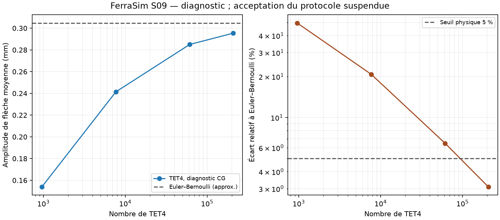

# S09 — Poutre et convergence : livraison suspendue

Lancé le 15 octobre 2026. Étude et outillage reproductibles ; acceptation S09 suspendue après échec du protocole numérique. Aucune qualification scientifique indépendante annoncée.

## Protocole et livrables

Le [protocole v1](../../validation/CANTILEVER-PROTOCOL.md) fixe géométrie, traction, référence Euler–Bernoulli, intégration surfacique, famille emboîtée et critères avant mesure. Le [pilote Python](../../validation/run_cantilever.py) génère les entrées MSH/JSON, appelle le binaire natif release, archive empreintes SHA256, résidus, bilans, temps mural et pic RSS. Aucun paquet Python supplémentaire n'est requis.

Le [contrôle géométrique](../../validation/check_cantilever_generator.py) vérifie orientations positives, volume, conformité des faces, emboîtement, aire chargée, intégration d'un champ affine et déterminisme des entrées, séparément du solveur Rust. Les grands fichiers sont régénérables dans `target/` ; les synthèses mesurées sont conservées dans le dépôt.

## Investigation

Le premier niveau passe CG avec la tolérance prescrite. Le deuxième (m=4) échoue après 30000 mises à jour : résidu frais 3,6022308251611506×10⁻⁹, seuil 2,190978754336317×10⁻⁹. La CLI retourne 4, sans publier de résultats. L'échec est conservé, sans modification du seuil d'acceptation physique de 5 %.

Une seconde série, explicitement diagnostique, emploie rtol=10⁻⁸ pour examiner la discrétisation. Ce mode ne peut annoncer la validation S09, même si la flèche finit par respecter les 5 %. Il ne remplace pas le protocole v1 ni son contrôle algébrique à 10⁻¹². Les résidus récursif et recalculé peuvent diverger en précision finie ; le résidu frais reste le seul critère de succès du solveur. La cause exacte du plancher observé n'est pas encore établie ; le conditionnement et l'accumulation des arrondis sont des pistes à vérifier, pas un diagnostic démontré.

Une [sonde du budget CG](../../validation/results/cantilever/residual-budget.json), avec m=4 et tous les autres paramètres du protocole conservés, donne les résidus frais suivants : 30,58 à 1000 itérations ; 3,3791×10⁻⁹ à 2000 ; 3,4399×10⁻⁹ à 4000 ; 3,5103×10⁻⁹ à 8000 ; 3,6022×10⁻⁹ à 30000. Les quatre sondes échouent explicitement, sans stdout ni répertoire de résultats. Ce plateau observé montre qu'augmenter seulement le budget ne résout pas ce cas ; il ne prouve pas à lui seul l'origine des erreurs d'arrondi. Pour reproduire la sonde, générer m=4, modifier seulement `solver_settings.max_iterations` aux budgets indiqués, puis appeler la CLI avec les échelles du protocole et des destinations neuves.

## Mesures diagnostiques locales

macOS ARM64, Rust 1.96.0, Python 3.14, binaire release issu du socle `0036e5a` sans modification Rust. Une exécution par niveau ; durée CLI complète, pic RSS en Mo décimaux. La génération Python et la compilation sont exclues des temps. Les entrées détaillées se régénèrent ; les synthèses conservent les empreintes et l'environnement.

| m | Nœuds | TET4 | Flèche moyenne (mm) | Écart EB | Temps (s) | RSS (Mo) | CG |
| --- | ---: | ---: | ---: | ---: | ---: | ---: | ---: |
| 2 | 369 | 960 | -0.153955828 | 49.4832 % | 0.15 | 19.3 | 720 |
| 4 | 2025 | 7680 | -0.241386596 | 20.7950 % | 1.99 | 92.8 | 1716 |
| 8 | 13041 | 61440 | -0.285058376 | 6.4652 % | 29.81 | 406.0 | 3489 |
| 12 | 40729 | 207360 | -0.295334366 | 3.0934 % | 130.23 | 1390.4 | 5196 |

Ces quatre niveaux donnent un écart décroissant jusqu'à **3,0934 %**, sous le seuil physique, uniquement en mode diagnostique. Maximum des bilans normalisés force/moment/résidu libre/énergie : 7.869e-09, sous 10⁻⁶. Cela ne lève pas l'échec du protocole ni ne remplace l'étude de sensibilité algébrique. Le maillage fin comporte 122187 degrés de liberté avant élimination.



[Synthèse protocole v1](../../validation/results/cantilever/protocol-v1.json) · [Synthèse diagnostique](../../validation/results/cantilever/diagnostic.json). Les mesures sont exploratoires ; aucune courbe de complexité ni garantie de temps/mémoire n'est déduite d'une seule exécution.

```sh
# Après activation du toolchain Rust et construction release :
python3 validation/run_cantilever.py --output target/s09-reproduce
# Échec CG attendu au niveau m=4 sur l'environnement archivé.
# Diagnostic séparé, sans validation du sprint :
python3 validation/run_cantilever.py --output target/s09-diagnose --diagnostic-rtol 1e-8 --levels 2 4 8 12
```

Le pilote utilise seulement la bibliothèque standard. Le [tracé](../../validation/plot_cantilever.py) demande matplotlib, facultatif et absent du parcours CI. La formule de référence est dérivée dans le [cours universitaire de mécanique des poutres](https://pastewka.github.io/Micromechanics/lecture/chapter04.html) ; aucun code de ce cours n'est repris.

## Vérifications locales

Les 120 tests Rust existants passent sur macOS ARM64, ainsi que formatage, Clippy avec avertissements interdits, release, documentation Rust, schéma JSON, régénération des trois corpus antérieurs et contrôle des liens/du registre. Aucun changement du solveur ou de la formulation Rust dans ce sprint. Le contrôle géométrique et la reproduction des empreintes des entrées archivées passent ; une nouvelle exécution du pilote livré reproduit les trois premiers niveaux diagnostiques. Les chiffres ci-dessus proviennent de la série à quatre niveaux, distincte de cette répétition.

La CI ajoute les contrôles géométriques et la série diagnostique m=2,4,8 sur les trois systèmes. Cette CI vérifie l'outillage et le diagnostic ; un statut vert ne vaut pas acceptation du protocole S09. Le niveau m=12 a été exécuté localement sur macOS seulement.

La [CI du commit `d80038c3122e4a4780c4ed22c14b9401c66b7259`](https://github.com/ROSITO/ferrasim/actions/runs/38712154072) passe sur Windows, macOS et Linux : contrôles existants, géométrie, empreintes des entrées et trois niveaux diagnostiques. Acceptation scientifique S09 toujours suspendue.

## Limites et suite

La référence Euler–Bernoulli est un modèle de poutre, pas la solution exacte du solide 3D. Une erreur décroissante sur cette famille ne démontre pas à elle seule la convergence vers la solution 3D ; aucune extrapolation ni qualification des contraintes à l'encastrement n'est revendiquée. La comparaison externe reste prévue en S10.

Avant de clôturer S09 : résoudre ou caractériser l'échec CG, vérifier l'effet de la précision algébrique au niveau fin, puis satisfaire tous les critères du protocole. Ne pas passer cette étude au statut vérifié sur la seule base du mode diagnostique.
